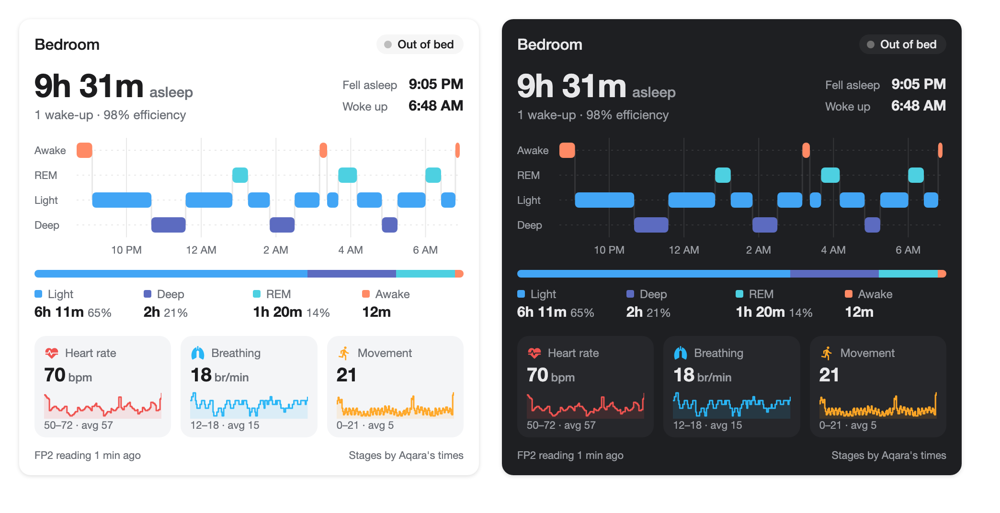
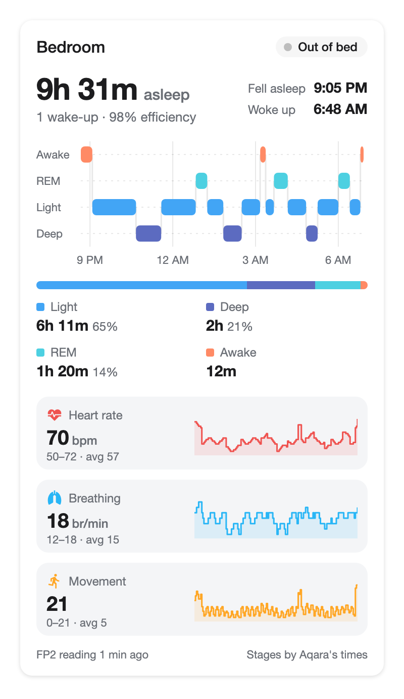

# Aqara FP2 Sleep

A Home Assistant integration for the sleep monitoring mode of the Aqara
Presence Sensor FP2: heart rate, breathing, body movement, sleep stages and
each night's totals, with a dashboard card.

The FP2 only shares sleep data with Aqara's cloud, not over HomeKit or
Matter. This integration reads it the way the Aqara Home app does, through
Aqara's app API, with your Aqara Home account. There is no developer
account, API key, MQTT broker or add-on to set up.



## Setup

1. In the Aqara Home app, set the FP2's work mode to **Sleep monitoring**.
2. Install through HACS (custom repository
   `https://github.com/kkrankall/aqara-fp2-sleep`, category Integration),
   then restart Home Assistant.
3. **Settings › Devices & services › Add integration › Aqara FP2 Sleep.**
   Sign in with your Aqara Home account and pick the region your app uses.
   The integration lists the FP2s on the account; with one FP2 it is set up
   straight away.

Your phone stays signed in. The integration keeps its own session and
stores only an MD5 hash of the password, which is what Aqara's sign-in
needs; when Aqara asks for a new sign-in, Home Assistant asks you for the
password again.

## Entities

| Entity | |
| --- | --- |
| Heart rate, Respiration rate, Body movement | Live readings, about every minute. `measured_at` is when the FP2 took the reading. |
| Sleep stage | Out of bed, In bed, Awake, REM, Light, Deep. |
| Night asleep, Night light / deep / REM sleep | Hours since 18:00, by Aqara's own times (see below). `Night asleep` carries the night's stage changes for the card. |
| Fell asleep, Woke up | Times from the same stage changes. |
| Illuminance | The FP2's light sensor. |
| FP2 mode, FP2 online, Connection problem | Diagnostics. A repair appears if the FP2 leaves Sleep monitoring mode. |
| Sleep state code | Aqara's raw stage code (0-5), disabled by default. |

Entity ids start with `aqara_fp2_sleep_`, the same as the SleepRadar app's,
so history and dashboards carry over when switching from it.

### Why the night totals are exact

The FP2's sleep stage reaches Aqara's cloud 7-19 minutes after it changes,
so counting time-in-state as values arrive in Home Assistant is off by
however much that delay varies. The integration reads the night's stage
changes from Aqara's history log, which carries the time each change
happened, and adds up the time between them. The latest change counts only
once the next one arrives, so a total never runs ahead of Aqara and is exact
by morning.

## Card

The integration serves `custom:fp2-sleep-card` to every dashboard; no
resource to add.

```yaml
type: custom:fp2-sleep-card
name: Bedroom          # optional
device_id: …           # optional, when there is more than one FP2
show_vitals: true      # optional
```

It shows time asleep, when sleep started and ended, a hypnogram of the
night by Aqara's times, the stage breakdown, and heart rate, breathing and
movement through the night. It follows the dashboard's light or dark theme
and stacks the vitals on narrow screens. It also works with the SleepRadar
app's entities, drawing stages by arrival time.



The screenshots use made-up data.

## Polling

By default Aqara is polled every minute from 18:00 to 12:00 and while
someone is in bed, and every five minutes otherwise.

To poll only when someone is around, pick a local presence sensor for the
same room under **Settings › Devices & services › Aqara FP2 Sleep ›
Configure**, for example the FP2's own presence sensor in HomeKit. Then:

- while the sensor sees someone, Aqara is polled every minute, and the
  moment it turns on there is an immediate read;
- after it clears, polling stays at every minute for 30 minutes, because
  Aqara's last stage change (out of bed) arrives up to ~20 minutes late;
- while the room is empty, Aqara is polled every 30 minutes, which keeps
  FP2 online, the sleep-mode repair and the 18:00 night rollover current;
- if the sensor becomes unavailable, polling carries on as if someone were
  there.

Nothing is lost while polling is idle: the night totals, fell-asleep and
woke-up times come from Aqara's history log, and each read picks up from
the last one.

The night's stage changes are re-read at most every five minutes, the device
list (name, firmware, room) every six hours.

## Notes

- The heart rate depends on the FP2's view of the chest. If it holds one
  value all night, the FP2 is not getting a reading; REM sleep also needs
  it.
- Regions: USA (Americas and others), Europe, China, Russia, South Korea.
